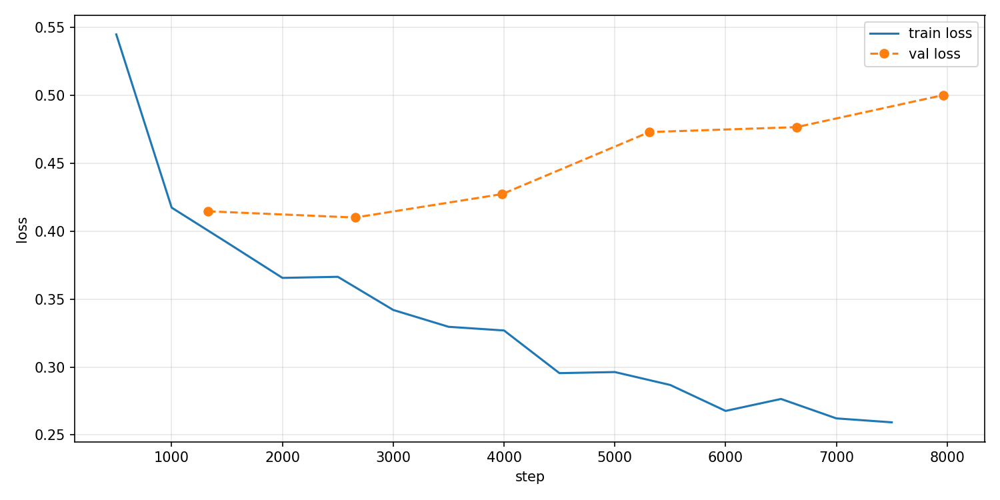
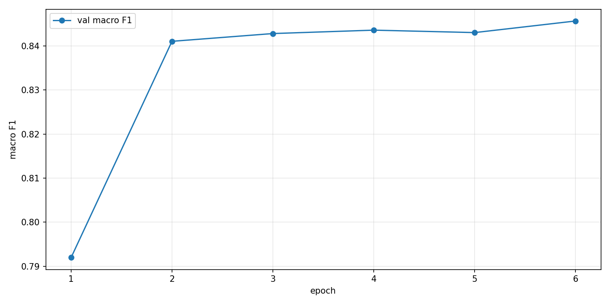
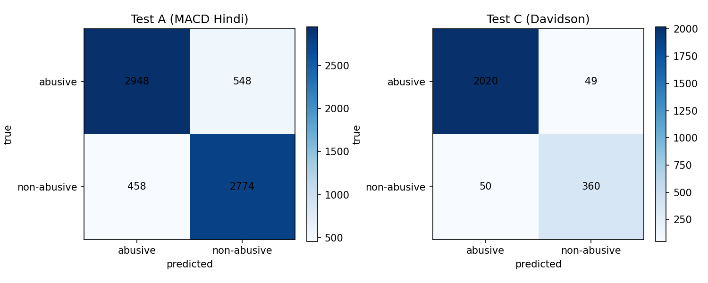

# Results

_Generated from FINAL pipeline · 2026-08-24 16:56 UTC_

**Labels:** 0 = abusive, 1 = non-abusive

## Held-out tests (PyTorch FP32, argmax)

| Set | N | Acc | Macro F1 |
|---|---:|---:|---:|
| A — MACD hindi_test | 6728 | **85.05%** | 85.04% |
| C — Davidson holdout | 2479 | **96.01%** | 92.76% |

## Threshold sweep (MACD val, P(abusive))

| Threshold | Acc | Macro F1 |
|---|---:|---:|
| 0.50 | 84.57% | 84.57% |
| 0.65 | 84.50% | 84.50% |
| 0.80 | 84.11% | 84.11% |

## Deploy

| Artifact | Value |
|---|---|
| PyTorch checkpoint | `checkpoints/v1/` |
| INT8 ONNX (shipped) | **118.3 MB** |

## Extension (systems)

- Viewport-only scan (IntersectionObserver); batch classify in service worker
- Store abusive hits only: SHA-256 + 280-char preview, max 100 rows, 30-day TTL
- Append-only hash chain; Verify + Export JSON in popup
- Auto-export JSON on HIGH severity via `chrome.downloads`
- Threat model: tamper-**evident**, not hacker-proof (DevTools can wipe storage)

## Curves

## Sample errors

See [errors.md](errors.md).
